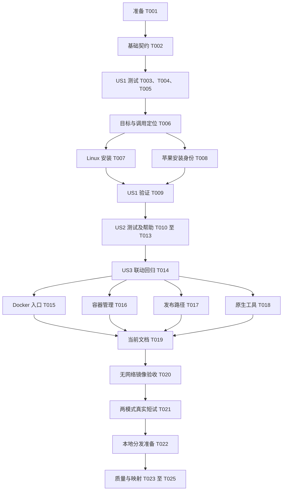

# 任务清单：统一使用 vap 命令

**日期**：2026-10-15，上海时区。
**输入**：[规格](spec.md)、[计划](plan.md)、[研究](research.md)、[模型](data-model.md)、[命令契约](contracts/cli.md)、[部署契约](contracts/deployment.md)、[验收指南](quickstart.md)。
**治理依据**：[项目章程](../../.specify/memory/constitution.md)。
**范围**：移除旧公开入口，只提供 vap；保留包、镜像、策略、数据、协议及内部授权身份。三个故事按优先级组织，已有项目不重复初始化或新增无关基础设施。
**测试依据**：规格明确要求帮助无副作用、退出状态一致、安装冲突拒绝和适用代理回归，因此安排测试先行。文档及纯路径迁移复用适当回归，不逐行镜像实现另造测试。
**状态**：共 29 项，2026-10-16 首轮实施、收敛及代码审查修复均已完成本地交付范围验证；首轮证据见[实施记录](../../docs/validation/vap-cli.md)，T026/T027 见[收敛验证](../../docs/validation/vap-convergence-20261016.md)，T028/T029 见[审查修复验证](../../docs/validation/vap-review-fixes-20261016.md)。编号仅属于本功能，不改变 `001` 任务状态或历史报告。

**一致性修订（2026-10-15）**：U1 的生产安装/退休规则已具体化并纳入 T004/T007/T009/T019；I1 的故事一早期阶段改称核心实现增量，实际四场景在 T021 合并验收；I2 的规格状态已更新。修订时任务仍为 25 项且未执行；后续实施结果按下方勾选及验证记录追溯，不改变旧功能待验收范围。

## 格式与路径约定

任务采用 `- [ ] T编号 [P可选] [US编号可选] 描述及路径`。路径均相对仓库根目录；新文件明确标注。故事阶段必须包含故事标签，准备/基础/收尾阶段不包含。`[P]` 仅表示前置任务完成后，可与同组其他文件任务并行，不授权绕过依赖或共享文件同时编辑。

## 阶段一：准备

**目标**：复用现有工程，固定本次变更及验证边界。

- [X] T001 在新建 `docs/validation/vap-cli.md` 记录当前提交、平台、已有验证引用及本轮未执行范围；依据 `specs/002-rename-cli-vap/research.md` 核对执行路径清单，区分待改程序入口与保留的项目/镜像/AppArmor/许可/数据标识，记录历史材料不得改写及不自动推送/打标签的边界，不重复无关联的容量测试。

## 阶段二：共同基础

**目标**：先建立唯一产品目标的可验证约束，不扩大项目架构。

- [X] T002 在新建 `scripts/test_cli_artifacts.py` 增加构建目标契约：使用 Cargo 元数据验证产品 bin “固定 vap，唯一产品命令”，包及库身份保留；从指定干净产物目录核对 vap 存在、旧名产品缺失，不能依赖开发机残留 target；先在当前实现上确认预期失败，后续 T006 完成后重新通过。依据 `Cargo.toml`、`specs/002-rename-cli-vap/data-model.md`，不将全仓库没有旧字符串作为断言。

**检查点**：基线和产物契约已明确，预期失败可进入对应实现；意外基线失败应先定位，不把既有问题混入改名结论。

## 阶段三：用户故事一——用短命令管理代理（US1，优先级一）

**目标**：真实程序名为 vap，run/status/stop 和安装归属保持正确。
**阶段独立验证**：干净构建、受控无覆盖安装及本地控制契约通过，只认定核心实现增量；同一实例的状态结构、就绪返回 3、通信/参数/回收退出状态和停止语义不因改名改变。US1 的实际启动、状态、就绪、停止四场景在 US3 的 T021 合并验收，完成之前不认定 US1 整体完成，也不宣布全部原生支持。

### 测试先行

- [X] T003 [P] [US1] 在 `tests/contracts/cli.rs` 补新入口的真实进程契约：run 保留必填 --config、status/stop 保留 --runtime-dir、--json 与 --check-ready 可组合；使用现有受控控制端验证机器状态不混日志、正常/失败/未就绪/回收失败的 0/1/3/4 语义及重复停止；将本文件的产品定位预期改为 `CARGO_BIN_EXE_vap`，记录当前目标缺失的预期失败，勿重写已有状态协议。
- [X] T004 [P] [US1] 新建 `scripts/test_install_vap.py`，先定义 `contracts/deployment.md` 的全部生产安装及旧入口退休正反例：实际/有效 UID 0、目标 UID/GID 0 且 `0755`、祖先权限/链接、源 UID 及 SUDO_UID、独立普通文件/链接数/1 字节至 64 MiB/危险模式、同一描述符快照及 SHA256；PATH 空项/相对目录拒绝、root 保护链接目录规范化及未知链接拒绝、同名节点冲突、失败暂存清理和并发只允许一个成功。补合法旧入口退休、缺失/伪造/可写记录、错误材料、节点替换、存活/未知消费者拒绝、无关命令/备份不变。低权限测试仅测纯组件或拒绝，真实成功路径在无网络独立 Linux root 环境/容器执行；不增加生产跳过校验选项、不操作宿主系统目录。
- [X] T005 [P] [US1] 在 `src/platform/program.rs` 的既有测试中先补新 basename 及记录绑定回归：继续使用 “format_version、version、binary_path、binary_sha256、system_libraries”；新记录的 “binary_path 文件名必须是 vap”，拒绝旧名、错误路径/摘要/版本及未知目标，保留原子不覆盖与权限行为；当前实现应出现预期失败，普通测试不得代替管理员安装验收。

### 实现与独立验证

- [X] T006 [US1] 在 `Cargo.toml` 声明唯一 `[[bin]]` 名称 vap、路径 src/main.rs，禁用隐式二进制发现并指定默认运行目标；在 `src/main.rs` 固定公开名称/用法为 vap。同步 `tests/contracts/cli.rs`、`tests/contracts/probe.rs`、`tests/container_environment.rs`、`tests/integration/lifecycle.rs`、`tests/integration/network_foundation.rs`、`tests/integration/support.rs`、`tests/integration/tunnels.rs` 的 `CARGO_BIN_EXE_vap` 定位，保持库导入及包身份；让 T002/T003 恢复通过，不添加旧名别名、第二产品目标或包装器。依赖 T003—T005 已定义预期。
- [X] T007 [US1] 新建 `scripts/install-vap.py`，严格实现 `contracts/deployment.md` 的 Linux 生产安装规则：默认 `/usr/local/bin/vap`、实际/有效 UID 0、目标 UID/GID 0 且 `0755`、祖先链及 PATH 校验、源快照/摘要/属主/类型/长度约束；经核验目录描述符完成暂存、排他提交和最终 root:root/0755/摘要/链接数复核，不继承源扩展属性、访问控制列表或文件能力。提供与新安装分开的明确旧入口退休操作，要求可信旧记录、对应材料和可复核停止回收证明，删除前复核节点身份；未知归属拒绝，不补写历史记录。默认安装不隐式退役、不自动启动/停止/全局清理，失败只回收本次暂存；运行 T004 回归，开发 Cargo 安装不替代生产保证。依赖 T006。
- [X] T008 [US1] 在 `src/platform/program.rs` 同步新 NAME、安装产物、记录生成/decode/verify_current 的 vap 路径，保留固定父目录、版本摘要目录、管理员链、模式、系统库及 NOREPLACE 核验；不修改 `src/platform/process.rs`、`src/platform/spawn.rs` 的租约/回收/描述符语义，正式派生继续使用已核验绝对路径，不能搜索 PATH。运行 T005 及既有保护安装/派生回归。依赖 T006。
- [X] T009 [US1] 按 `specs/002-rename-cli-vap/quickstart.md` 在干净目录构建并验证 T002—T008 的核心实现增量；普通组件与真实 Linux root 安装/退休正反例分别记录，未知或存活消费者不得移除旧入口。使用 `tests/contracts/cli.rs`、`tests/integration/lifecycle.rs` 的可执行范围核对本地控制协议、内部程序定位及退出语义，将产物名、安装/退休证据、命令和平台/特权未执行项写入 `docs/validation/vap-cli.md`；完整实际代理四场景留待 T021，不将本任务通过标为 US1 整体完成。依赖 T007、T008。

## 阶段四：用户故事二——通过帮助了解操作（US2，优先级一）

**目标**：中文帮助完整、公开用法统一、查询无服务副作用。
**独立验收**：总览、三个详情及版本查询成功；必填参数不阻碍显式帮助；未知、缺失及隐藏目标拒绝。无配置、非管理员、无网络的实际容器验证在 T020 补齐，不能仅以清空 PATH 声称没有联网。

- [X] T010 [US2] 在 `tests/contracts/cli.rs` 先补帮助与错误真实进程测试：vap help/--help、help run/status/stop 及对应子命令 --help；中文标题/参数含义、用法前缀、项目与实际版本辨识、隐藏命令不展示；无子命令、未知操作、缺参数及未知/隐藏帮助目标返回 2，标准错误指向 vap help。核对独立工作目录无实例/缓存创建，保留 T003 状态契约；先确认预期失败。依赖 T009，避免与 T003/T006 同时编辑本文件。
- [X] T011 [US2] 在 `src/main.rs` 复用锁定 clap 实现显式公开 help 路由和中文总览/详情/内置帮助选项说明；落实“总览和 run/status/stop 详情成功返回中文说明与退出状态 0；无效或隐藏目标返回参数错误 2”。补 --config、--runtime-dir、--json、--check-ready 及未就绪 3 的说明和操作示例，帮助不要求运行必填参数，也不进入服务初始化。依赖 T010。
- [X] T012 [US2] 在 `src/main.rs` 完善参数错误与版本显示：无子命令、未知操作和参数错误均以中文分类写标准错误并指向 vap help、返回 2，不默认启动；版本以 vap 开头并辨识项目及实际程序版本，不把镜像标签当作包版本。保留隐藏内部命令解析与授权路径，帮助/版本在任何网络、配置或特权初始化前结束。依赖 T011，同文件串行。
- [X] T013 [US2] 运行 `tests/contracts/cli.rs` 中 T010 新增用例与原退出状态/状态兼容回归，在 `docs/validation/vap-cli.md` 记录中文内容、参数错误、隐藏帮助拒绝及无配置/非管理员结果；无网络强约束指向待执行 T020，不以模拟证据替代。依赖 T012。

## 阶段五：用户故事三——部署与说明统一入口（US3，优先级二）

**目标**：新镜像、管理工具、许可/摘要提取及当前说明都执行 vap，只有合法项目身份和历史记录保留旧字符串。
**独立验收**：新镜像旧路径不是文件也不是链接；默认入口、健康检查、环境/JSON 两模式真实受控链路和来源核验均通过；当前命令示例一致，不推送标签或镜像。

### 联动回归与实现

- [X] T014 [US3] 在 `scripts/test_cloud_deploy.py`、`scripts/test_docker_publish.py`、`scripts/test_release_package.py` 增加或调整既有命令执行/打包回归：容器管理及程序摘要读取必须选择 vap，来源归档仍包含必要构建/安装文件并排除秘密；保留镜像目标约束和环境模式验收门槛，记录旧路径导致的预期失败，不新增仅镜像字符串替换实现的测试。依赖 T013。
- [X] T015 [P] [US3] 在 `Dockerfile` 更新构建产物及复制目标为 `/usr/local/bin/vap`，健康检查执行 vap status；在 `deploy/entrypoint.sh` 同步环境配置生成和最终执行路径，保留 tini、显式参数、JSON 默认模式及环境临时配置逻辑。新镜像不添加旧名文件/链接，许可目录和 AppArmor/编排标识保持原值。依赖 T014。
- [X] T016 [P] [US3] 在 `scripts/cloud_deploy.py`、`scripts/validate_docker.py` 将容器状态/就绪/停止等真实调用改为 vap，保留原权限、秘密、标签归属、正常清理及缓存行为；复用 T014 管理回归，不扩大控制通道或修改健康与 ready 的区别。依赖 T014。
- [X] T017 [P] [US3] 在 `scripts/collect_runtime_notices.py`、`scripts/prepare_docker_publish.py`、`scripts/package-docker-release.py`、`scripts/package-cloud-validation.py` 将实际程序读取、动态库核验、摘要和恢复示例路径改为 vap；保留项目/镜像/许可路径及同一镜像来源冻结门槛，保留新安装脚本在来源目录白名单中的覆盖；运行 T014 发布/打包回归。依赖 T014。
- [X] T018 [P] [US3] 在 `scripts/validate-linux.sh`、`scripts/validate_soak.py`、`scripts/prepare-macos-dependency.py`、`scripts/test_macos_dependency.py`、`scripts/test_macos_tunnel_launcher.py`、`scripts/test_macos_verified_worker.py` 同步实际原生构建产物和容器内程序定位为 vap；不改历史材料/实验依赖名称、镜像名或资源归属；核对其余执行残留并逐项归类，不运行无关联三十分钟容量。依赖 T014。
- [X] T019 [US3] 在 `README.md`、`docs/deployment.md`、`docs/dockerhub-release.md`、`deploy/cloud/README.md`、`deploy/release/README.md` 和 `specs/001-vpngate-auto-proxy/contracts/cli.md` 同步当前可执行命令；补 Linux 生产安装的实际参数及 root/0755/无链接/摘要约束、苹果受保护目录 PATH 用法，明确旧入口退休所需可信历史记录/发布材料/停止回收证明及正反验收。手工旧部署缺记录时必须拒绝自动退休，不指导用户按文件名或手填摘要删除；遵守“新交付不存在；历史包及用户备份不回写”，不改旧报告、旧规格验收事实或上游声明。依赖 T015—T018。

### 实际产物验证

- [X] T020 [US3] 按 `specs/002-rename-cli-vap/quickstart.md` 构建独立本地候选镜像，检查 `/usr/local/bin/vap` 可执行、旧路径既非文件也非链接、健康检查用新入口；在 --network none、--cap-drop ALL、--read-only、非管理员且无配置/秘密/卷的容器中验证所有公开帮助和版本，另验证未知/隐藏帮助目标返回 2，记录 `docs/validation/vap-cli.md` 的真实身份与结果。依赖 T019；此前模拟/清空 PATH 不能代替此无网络证据。
- [X] T021 [US3] 使用 `scripts/validate_docker.py` 对 T020 同一镜像分别执行 JSON 与 --environment-config 受控短试，补齐 US1 的实际启动、状态、就绪、停止四场景，并确认认证/拒绝、缓存重启、地区/时区、无匹配等待、故障阻断恢复及清理；专用策略目标宿主增加 --require-apparmor，没有强制模块时明确记录缺口。将 US1/US3 场景、实例/镜像/程序身份及通过范围写入 `docs/validation/vap-cli.md`，在该实际范围齐备后才认定 US1 对应场景完成，不创建公共节点试验或发布。依赖 T020。
- [X] T022 [US3] 用 `scripts/prepare_docker_publish.py` 及现有采集/核验工具完成新 vap 镜像的本地发布准备和完整来源归档核对，可复用已校验来源缓存；核对提取的是 `/usr/local/bin/vap`、程序摘要与受控验证一致、包内有新安装/构建材料，原文和依赖身份无误。记录 `docs/validation/vap-cli.md` 的新材料及验证摘要，保留历史归档不覆盖；本地缺少强制模块不冒充 T111/T112 远端发布通过。依赖 T021。

## 阶段六：整体质量与追溯收口

**目标**：形成可审查的新命令交付，保持既有未完成平台和发布任务独立。

- [X] T023 运行 `specs/002-rename-cli-vap/quickstart.md` 的格式、严格静态、普通 Rust 与 Python 回归；按新变更/失败适当扩展测试，不机械重跑已通过容量。更新 `docs/validation/vap-cli.md` 的通过、失败、忽略、未执行数量及实际命令，任何帮助副作用、身份替换、认证/故障阻断或回收失败均阻止交付。依赖 T022。
- [X] T024 按 `specs/002-rename-cli-vap/quickstart.md` 的十项需求/四项成功标准逐项核对完成证据，复查当前执行命令残留及合法项目身份例外；在 `docs/validation/summary.md`、`docs/validation/remaining-work.md` 添加本次独立范围及真实目标缺口，不覆盖历史记录、不凭改名勾选 `001` 的 Linux 原生、苹果恢复或 T111/T112。依赖 T023。
- [X] T025 核对 `specs/002-rename-cli-vap/{spec.md,plan.md,data-model.md,contracts/cli.md,contracts/deployment.md,quickstart.md,tasks.md}` 与最终产物和验证记录一致，更新实施状态、实际矩阵及未执行项；检查清单只读，不将设计审查改为实施通过。实际有证据才逐项勾选本任务清单，保留用户明确移除旧入口的决定；本任务不提交/推送代码或标签。依赖 T024。

## 依赖与执行顺序

- 故事一和故事二同为优先级一，但共享 `src/main.rs`、`tests/contracts/cli.rs`，按 US1 → US2 串行，避免合并后行为无法归因。
- 故事三可以在新入口核心稳定后独立准备，但本清单的执行顺序先完成两个优先级一故事；并行仅限明确标记且已满足前置的文件组。
- T007 与 T008 都依赖 T006，可在各自测试先完成后独立处理；T003—T005 各测试组也可并行。没有目标特权环境不妨碍普通组件实现，但相应目标验收不能勾选或计为通过。
- T015—T018 在 T014 完成后可并行，彼此文件不重叠；T019 必须等待四项完成，T020—T025 是依赖实际产物的顺序门槛。
- 原有 Linux 原生/苹果完整网络/远端发布缺口不作为本次 Docker 命令路径之外的额外门槛；本次任何未验证范围仍必须如实保留，不能宣称全部平台已完成。

## 每个故事的并行示例

| 故事 | 可并行组 | 必须等待及共享文件限制 |
| --- | --- | --- |
| US1 | T003 CLI 契约、T004 安装脚本测试、T005 受保护安装测试 | 先完成 T002；测试先于各实现，T006 与 T003/T010 不同时编辑 CLI 测试；T007/T008 实现彼此独立 |
| US2 | 不安排本故事内并行修改 | T010 → T011 → T012 → T013；共享 main.rs 和 CLI 测试，禁止将两个实现同时编辑 |
| US3 | T015 Docker/入口、T016 管理工具、T017 来源/打包工具、T018 原生验证工具 | 先完成 T014；T019 文档和后续实际产物核验等待合流 |

并行指可独立执行的文件任务，不要求实施时委派代理。

## 实施策略与最小交付

1. 复用已有工程与验证基线，先冻结范围及写出失败的唯一目标契约。
2. 最小实现增量为 US1 的 T003—T009：真实 vap 文件、无覆盖安装和本地控制契约；仅用于独立验证，不认定故事一全部场景或对外交付完成。其真实四场景由 T021 合并验收。
3. 补齐用户明确要求的 US2 中文帮助及错误操作，优先完成两个优先级一故事。
4. 接通 US3 所有调用路径并完成镜像真实短试、来源核验；对外 Docker 交付必须包含 US1、US2 和 US3 适用门槛，不能只发布改名的文件。
5. 保留既有目标矩阵缺口，以新证据完成本功能，随后再由维护者单独触发真实版本发布。当前轮不修改代码、执行网络实验、提交或推送。

## 需求与任务追溯

| 需求 | 主要任务 | 成功标准 |
| --- | --- | --- |
| 需-001 | T002—T009、T015、T020—T021 | 成-001 |
| 需-002 | T003、T006、T009、T010—T013、T016、T021 | 成-001、成-004 |
| 需-003 | T002、T004—T008、T015、T019—T020 | 成-003 |
| 需-004—需-006 | T010—T013、T020 | 成-002 |
| 需-007 | T003、T009—T013、T020—T021 | 成-004 |
| 需-008 | T014—T018、T020—T022 | 成-001、成-004 |
| 需-009 | T019、T024—T025 | 成-003 |
| 需-010 | T004—T009、T010—T013、T020 | 成-002、成-003 |

质量清单的勾选代表需求审查，不能代替本文件实施证据。无法执行的目标用例标明前提和未执行原因；不将未执行默认为通过，不在日志或归档写入秘密。

## Phase 7: Convergence

2026-10-16 收敛核对：以下为当前实现相对既有规格、计划及任务的剩余工作；原任务及其完成标记保留。仅追加任务，不修改实现、规格或计划。原生目标矩阵、苹果完整后端、新镜像强制策略及真实远端发布继续按既有独立范围记录，不因本次收敛新增为命令改名的完成门槛。

- [X] T026 [US1] 修复 F001（高）：在 `scripts/install-vap.py:290` 收紧旧入口退休的公开目录判定，禁止仅凭路径中包含 `/bin/` 就放行；实际父目录必须满足公开入口约束，备份、数据及受保护历史目录必须拒绝，即使其祖先目录名含 bin。保留可信记录、材料、停止证明及提交前身份复核，不以新路径规则代替已有归属校验。在 `scripts/test_install_vap.py` 先补 `/opt/application/bin/backups/vpngate-auto-proxy`、`/opt/application/bin/data/vpngate-auto-proxy` 等非公开父目录的失败测试，并在无网络独立 Linux 管理员容器验证：拒绝且原节点/证据/备份不变，合法公开 bin 目录的退休仍通过。更新本轮验证记录和受影响分发来源核验，不覆盖历史归档。依据需-003、边界“不得删除用户保存的旧程序”、plan: 旧入口退休与备份保留、T004/T007/T009/T019（contradicts）。
- [X] T027 [US2] 补齐 F002（低）：在 `tests/contracts/cli.rs` 先为无参数调用补标准错误包含中文 `用法：vap`、标准输出为空、退出 2 且不创建资源的回归；在 `src/main.rs` 显示计划要求的中文用法，并将错误中的 `vap help run/status/stop` 改为实际有效的帮助命令或明确的操作占位说明。保留公开帮助成功、隐藏目标拒绝及原有退出语义。运行命令契约及无网络非管理员帮助/错误核查，更新验证证据；如程序摘要改变，按 T020—T023 的既有门槛重建并验证对应候选和来源材料。依据需-004、需-007、US2/AC4、plan: 命令与帮助的无参数用法、T010/T012/T013（partial）。

2026-10-16 收敛实施结果：T026/T027 的新增测试先复现原缺口，修复后 Linux 独立管理员容器 17 项、命令契约 18 项及无网络帮助/错误 18 组通过；Rust 397 项通过、37 项忽略，Python 234 项运行、19 项跳过。新镜像两配置模式短试、完整本地分发准备及 1073 项项目来源一致性核对通过；新程序摘要、实例与候选归档见收敛验证记录。未提交、推送或发布，旧功能的平台与远端验收状态不变。

## 阶段八：代码审查修复

2026-10-16 用户授权修复代码审查发现的两项参数与安装边界问题；沿用现有规格，不扩大网络或发布范围。

- [X] T028 [US2] 先在 `tests/contracts/cli.rs` 复现 `--` 后的帮助标志及无效参数前置时错误返回成功，再由 `src/main.rs` 的既有解析器识别帮助选项，保留中文公开帮助和隐藏目标拒绝，尊重参数分隔符并返回错误 2；复核无副作用及现有退出契约。依据需-002、需-006、需-007、US2/AC4。
- [X] T029 [US1] 先在独立 Linux 管理员容器复现 SUDO_UID=0 的安装误拒绝，再调整 `scripts/install-vap.py`：0 保留 root 源属主权限，只有合法非零值扩展可选源 UID；非法值、无关源属主、权限、摘要和覆盖仍拒绝。更新契约、对应回归及审查验证记录；新程序镜像须完成两配置模式、无网络帮助及完整分发来源核验，旧归档不覆盖。依据需-001、需-010、T004/T007/T023。

2026-10-16 代码审查修复结果：T028/T029 已完成。CLI 19 项、Linux 独立管理员容器 18 项、无网络镜像帮助与错误 29 组通过；Rust 398 项通过/37 项忽略，Python 235 项运行/20 项跳过。新镜像两配置模式、最终分发短试、17 项包内摘要与 1073 项项目来源一致性核验通过。旧报告与归档保留，未提交、推送或发布。
