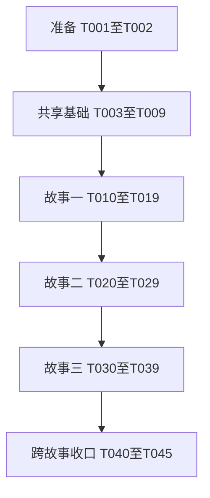

# 任务清单：节点综合优选与故障恢复

**输入**：[规格](spec.md)、[实施计划](plan.md)、[研究记录](research.md)、[数据模型](data-model.md)、[选择契约](contracts/selection.md)、[来源与诊断契约](contracts/source-diagnostics.md)、[验证指南](quickstart.md)。
**日期**：2026-10-22，上海时区。
**状态**：49项任务完成。T046至T048收敛修订及T049最终源码完整三十分钟长测通过；此前T043的人工接受及独立部署矩阵边界记录保留，未将其改为自动通过。
**组织方式**：用户故事一、二为优先级一；用户故事三为优先级二。先完成共同前置，再按故事增量交付。
**验证依据**：规格明确列出验收场景、可衡量结果，计划及章程要求关键行为自动化与受控网络证据，因此包含有针对性的测试任务。先补充会暴露旧行为的断言，再实现；因新接口不存在而无法编译不算行为验证通过，接口建立后须确认目标断言确实暴露缺失行为。

## 格式与路径约定

任务行使用 `- [ ] T编号 [P可选] [US故事编号可选] 描述与文件路径`。[P]只表示在已满足所列前置条件后可与不修改相同文件的任务并行；不表示允许跳过依赖。故事阶段全部带[US1]、[US2]或[US3]，其他阶段不带故事标签。

路径均相对仓库根目录；本功能文档位于 specs/004-rank-vpn-nodes/。复用 Rust 1.90、现有锁定依赖与测试入口，不新增框架、数据库、网络管理入口或常驻备用隧道。

需求审查清单 checklists/core-selection.md 由审阅者维护，实施收口读取为三十项均已勾选。本轮没有修改该清单；任务生成和实施勾选不代表需求审查或功能验收自动通过。

## 第一阶段：准备与共享验证入口

**目标**：固定验收入口与公共构造数据，避免零匹配测试和不同故事使用不同指标含义。

- [X] T001 在 docs/validation/node-selection.md 新建本功能验证记录框架，列出 quickstart.md 的必需命令、平台、工具链、有效用例数量、未执行项与资源回收栏；记录当前依赖及现有测试基线，核对 tests/contracts.rs、tests/integration.rs 和 src/platform/coordinator.rs 的真实入口，不把本轮规划、未运行测试或已有未勾选需求清单写成通过。
- [X] T002 在 tests/support/selection.rs 新建无网络的节点、配置身份、来源指标及受控时刻构造辅助，使用数据模型的三个手工样例和至少二十一个不同节点身份；在 tests/contracts.rs 登记辅助模块，保留既有模块与平台条件，不注册空测试模块或引入新依赖。依赖 T001。

## 第二阶段：共享基础，阻塞全部用户故事

**目标**：落实五项来源指标、旧缓存、身份与有界状态的公共边界。全部完成后，故事阶段才能开始。

- [X] T003 [P] 在 tests/contracts/domain.rs 增加质量字段缺失、正常字段、单项异常与身份不变的契约断言：质量更新不改变现有节点标识及净化配置摘要，来源时间沿用 source_fetched_at；整组质量对象错误形状和未知字段不得放宽现有拒绝规则。依赖 T002；与 T004 不修改相同文件。
- [X] T004 [P] 在 tests/contracts/storage.rs 增加有效旧缓存缺少 quality、新字段往返、单项非法值降为未知及整对象错误拒绝的契约，覆盖“来源上限 32 MiB、20,000 节点”、未来与过期时间、配置篡改、私有权限、链接拒绝，以及诊断不恢复成功、冷却和遍历。依赖 T002；与 T003 不修改相同文件。
- [X] T005 在 src/domain.rs 新增 SourceQualityMetrics 并嵌入 VpnNode，逐项落实数据模型的“可选无符号64位整数”：score“来源评分，无量纲，零有效”、speed_bps“比特／秒，零未知”、ping_ms“毫秒，零未知”、sessions“会话个数，零有效”、uptime_ms“毫秒，零有效，评分时先截到86,400,000再计算”；指标时间“与快照获取时间一致”，结构缺失或空对象兼容、整结构空值或数组拒绝、单项错误类型负值溢出为未知，保留拒绝未知字段；同步 src/、tests/、examples/ 中实际存在的 VpnNode 构造点并保持原测试含义。依赖 T003、T004。
- [X] T006 [P] 在 src/vpngate.rs 解析列2、3、4、7、8并规范化五项指标，先增加覆盖空白、负数、小数、正号、溢出、零值与重复行的单元断言；同配置重复行保留第一条有效配置行的整组指标，不同配置冲突继续整节点排除，质量异常不得拒绝连接配置本来有效的节点或扩大原响应限额。依赖 T005；可与 T007、T008 并行。
- [X] T007 [P] 在 src/storage.rs 接入质量字段校验和规范化，保持模式版本1、原子写入、来源地址和有效期、安全配置再校验、原大小及权限约束；新程序必须读旧缓存，旧程序读新缓存只承诺安全拒绝，不持久化或恢复运行期冷却和遍历。依赖 T005；可与 T006、T008 并行。
- [X] T008 [P] 在 src/scheduler.rs 建立共享 NodeKey、RoundPurpose、AttemptDisposition、NodeRuntime、SearchSession、RoundPlan 及冻结评定接口：身份“以节点及其配置身份区分”、用途“首次、恢复、后台”、结果“成功、节点失败、取消、失效结果、系统致命失败”、备用表“最多来源节点数，空间有界”，当前与历史身份并集“合计最多40,000条”，离开后只保留最小受保护历史而非配置正文；运行期记录以配置身份为键，明确最终尝试标识用于幂等完成，预留现有调用兼容直到各故事接入。依赖 T005；可与 T006、T007 并行。
- [X] T009 核对 tests/contracts/domain.rs、tests/contracts/storage.rs、src/vpngate.rs 与 src/scheduler.rs 的基础验证实际被发现并运行，修复构造与序列化回归，将命令、有效用例数量和边界结果写入 docs/validation/node-selection.md；基础阶段须保持既有业务可编译，不提前切换到未完成的评分行为。依赖 T006、T007、T008。

## 第三阶段：用户故事一——首次连接优先尝试综合表现好的节点（优先级一）

**目标**：按固定综合分选择候选，首次默认前两名并发、先真实验证成功者先启用；跨轮优先覆盖未尝试节点。

**独立验收**：清空运行期成功历史，使用可控来源与结果，核对甲72.5、乙67.5、丙10的分数及派发顺序；第二名先成功可启用；至少二十一个节点前二十个失败后首先尝试第二十一个。无需依赖故障恢复成功层级或后台探索功能。

### 先补充故事验收断言

- [X] T010 [P] [US1] 新建 tests/contracts/quality.rs，覆盖选择契约的手算分数、平均并列、仅一个有效值、全部相同、未知40分、运行时长封顶、极值及平局顺序；在 tests/contracts.rs 登记该模块，断言质量更新不影响节点身份和有效来源筛选，分数重复计算确定一致。依赖 T009；可与 T011、T012 并行。
- [X] T011 [P] [US1] 在 tests/contracts/scheduler.rs 增加首次综合分派发、默认并发两个、配置批量与并发为一、二十一个节点跨轮、取消不推进遍历、同指标刷新保持进度、首次出现配置与新增删除节点、已尝试身份消失重现及配置切回、失效备用补位不占配额的契约断言；使用受控时钟覆盖首次失败后的冷却边界；补齐标-010的四万条身份并集容量断言：第40,000条可保留，同键重现不重复占容量；新增第40,001个身份前先回收冷却已结束且不属于当前遍历的离开来源记录，受冷却或当前遍历保护的历史不得回收；全部记录受保护而仍需超限时返回固定类别 history_capacity_exceeded，未结束冷却和已尝试标记不丢失。依赖 T009；可与 T010、T012 并行。
- [X] T012 [P] [US1] 在 tests/fixtures/services.py 扩展逐节点五项指标、独立端口及延迟和失败控制，保持现有夹具默认行为，并在 tests/integration/startup.rs 新增前两名竞速、第二十一节点首次成功及真实出口请求用例；按需调整 tests/fixtures/setup-docker.sh 的受控映射，所有规则仅作用于专用测试资源。依赖 T009；可与 T010、T011 并行。

### 实现与接入

- [X] T013 [US1] 新建 src/quality.rs 并在 src/lib.rs 登记，实现数据模型“零至100,000,000的无符号整数，单位为百万分之一分”、权重“依序30、35、15、10、10”、中间扩宽及统一四舍五入；严格按 contracts/selection.md 的公式、统计总体、未知分、24小时封顶和稳定平局排序生成冻结评定，不在百毫秒控制循环反复全量评分。依赖 T010、T011、T012。
- [X] T014 [US1] 在 src/scheduler.rs 实现首次轮次和共享运行期完成逻辑：寻找会话跨轮保留配置身份集合，完整尝试结束才标记，前二十个失败后未尝试者优先，遍历完成且无在途才重开；“初始 30 秒”并按30、60、120、240、300秒冷却、成功清零，取消和失效不计；冻结主队列与备用顺序，失效不占配额，同配置刷新不重置状态；同身份重现恢复原冷却和当前遍历标记，不恢复旧成功资格；先回收无保护记录，四万条身份并集上限仍不足则通过现有错误通道以固定类别 history_capacity_exceeded 和固定中文说明报告并受控停止，不依赖调试事件是否启用，不静默丢弃受保护历史。依赖 T013。
- [X] T015 [US1] 在 src/service.rs 接入首次用途、评分与完整结果分类，默认并发两个且遵守配置上限；只提升当前来源与配置仍合法的真实出口成功节点，其余成功结果不得替换健康出口；提升结束寻找，原轮剩余固定任务按候选并发完成并回收，不重算分数或扩大配额，沿用系统与清理致命失败路径。依赖 T014。
- [X] T016 [US1] 在 src/platform/coordinator.rs 接入同一共享首次策略，修正当前首次连接也串行恢复的问题；补充替代依赖断言证明首次可并发、第二名先成功、提升唯一、剩余任务回收及旧配置结果不可提升，并保持现有代际归属和活动引用撤销语义。依赖 T015；共享调度接入稳定后修改另一协调器。
- [X] T017 [US1] 在 src/scheduler.rs、src/service.rs 和 src/platform/coordinator.rs 完成来源合并与首次等待边界：指标刷新不改变本轮顺序或遍历，首次出现配置身份未尝试，已有身份消失重现或切回旧配置保留其自身受保护历史，删除不阻塞，来源过期不新派发；无候选或仅剩未尝试冷却节点时有界等待，首次失败仍遵守现有整轮退避与工作槽回收。依赖 T016。
- [X] T018 [US1] 运行 tests/contracts/quality.rs、tests/contracts/scheduler.rs、来源及缓存契约与 src/platform/coordinator.rs 的首次替代依赖场景，确认非零有效用例并记录在 docs/validation/node-selection.md；证明首次默认前两名、相同状态确定排序、冷却不绕过、二十一个节点覆盖、同配置重现、T011已交付的四万条容量边界、历史回收与固定超限错误断言及取消不计失败；本阶段不依赖T027的恢复场景集成验证。依赖 T017。
- [X] T019 [US1] 在专用 Linux 环境按 specs/004-rank-vpn-nodes/quickstart.md 的首次入口运行 tests/integration/startup.rs，取得真实出口请求、竞速选择、二十一个节点及停止回收证据，记录平台、实际程序身份和未执行平台项至 docs/validation/node-selection.md；不以握手日志或零匹配结果代替。依赖 T018。

**阶段检查点**：首次优选可独立演示；尚未完成其他故事，不能称整个功能交付。

## 第四阶段：用户故事二——故障时优先恢复已经验证过的出口（优先级一）

**目标**：故障阻断后逐个重验证近期成功节点，使用冷却及跨轮遍历减少无效重试。

**独立验收**：预置有效和过期成功记录、不同配置及失败历史，触发真实或替代依赖故障；有效近期成功优先且恢复串行，旧连接终止，新出口验证前无业务转发，二十一节点遍历与退避符合规格。成功历史可由受控构造提供，不依赖用户故事三的后台探索。

### 先补充故事验收断言

- [X] T020 [P] [US2] 在 tests/contracts/failover.rs 补充恢复分层、成功时间同分、配置变化与过期或历史成功失效、恢复串行、当前遍历未尝试优先、完整失败只计一次、重复通知与取消不计、全部冷却及整轮退避、同配置零秒失败五秒消失十秒重现仍冷却至三十秒、配置切回的受控时钟契约。依赖 T019；可与 T021、T022 并行。
- [X] T021 [P] [US2] 在 src/platform/coordinator.rs 的替代依赖测试补充活动结构和出口同时失败只记一次、旧代际迟到结果不惩罚新配置、故障撤销与回收槽位后才恢复、恢复成功不被后来结果替换及二十一个节点的故障寻找场景。依赖 T019；可与 T020、T022 并行。
- [X] T022 [P] [US2] 在 tests/integration/failover.rs 增加按评分和本机近期成功恢复、前二十个失败后继续第二十一个、冷却等待、原活动节点不立即切回的用例，复用 tests/fixtures/services.py 的逐节点控制；断言旧连接终止、恢复期间不直连与成功后真实业务恢复。依赖 T019；可与 T020、T021 并行。

### 实现与接入

- [X] T023 [US2] 在 src/scheduler.rs 实现恢复用途：在当前遍历未尝试且可派发候选中先按有效本机近期成功时间降序，再按综合分及常规平局规则；轮次构造时冻结成功时间，避免 start_attempt 清除历史；恢复“最多一个在途验证”，已过期、上次运行或旧配置不得获得成功层级。依赖 T020、T021、T022。
- [X] T024 [US2] 在 src/service.rs 的统一故障分支接入一次活动失败冷却、取消旧业务引用与旧任务、确认回收后开启恢复寻找；最终尝试分类只更新一次，节点失败与致命系统或清理错误保持区分，未经新真实出口成功不得提升或直连，恢复成功后余下原轮任务遵守固定计划。依赖 T023。
- [X] T025 [US2] 在 src/platform/coordinator.rs 接入与 Linux相同的恢复状态通知、冷却与遍历，保留代际身份、健康结果序列、撤销与退役确认，不能用旧成功历史直接提升；保证结构和健康故障聚合一次、回收失败仍按原策略停止。依赖 T024。
- [X] T026 [US2] 在 src/scheduler.rs、src/service.rs 和 src/platform/coordinator.rs 分离来源退避、完整失败轮次退避、节点冷却及后台轮次期限：用单调时钟判断资格，资格到期“一秒内更新”，只有其他门槛均满足才派发；无活动且仅冷却等待时按最早到期唤醒，有健康活动时不绕过后台间隔，相同来源刷新不得重置退避。依赖 T025。
- [X] T027 [US2] 在 tests/contracts/failover.rs、tests/integration/failover.rs 和 tests/integration/lifecycle.rs 补充恢复取消、重复故障及退出中的冷却边界，覆盖未尝试冷却候选阻止提前开启新遍历、删除不阻塞、重现保留本遍历标记、遍历结束释放无保护历史、在T011共享容量契约基础上覆盖故障恢复期间容量超限后的活动引用撤销、受控停止及资源回收，不替代T018所需的前置容量断言、恢复成功结束寻找和下次故障重开寻找但不清除同配置冷却。依赖 T026。
- [X] T028 [US2] 按 specs/004-rank-vpn-nodes/quickstart.md 运行恢复契约、共享状态与苹果替代依赖场景，将实际结果写入 docs/validation/node-selection.md；证明成功优先、恢复串行、冷却和整轮退避、幂等计数、来源刷新及跨轮遍历相互兼容。依赖 T027。
- [X] T029 [US2] 在专用 Linux 环境运行 tests/integration/failover.rs 的真实故障链路和必要的 tests/integration/lifecycle.rs 回收场景，记录旧连接中断、恢复期间抓包无直连、真实重验证后恢复、二十一节点及退出无残留至 docs/validation/node-selection.md；苹果真实验收缺项单独保留。依赖 T028。

**阶段检查点**：首次和故障恢复均可独立验收；后台探索及详细原因解释仍待下一故事。

## 第五阶段：用户故事三——后台维护候选质量并解释选择原因（优先级二）

**目标**：健康出口保持稳定，后台按质量和探索配额维护候选，并给出有界、可核算的选择原因。

**独立验收**：固定一个健康活动出口，连续十轮改变来源指标；默认二十名额中探索四个、单名额交替、覆盖上界满足，活动出口不变，临时任务回收；调试事件能解释评分与跳过原因且不泄漏秘密。可直接预置活动出口，无需先运行整个故障恢复场景。

### 先补充故事验收断言

- [X] T030 [P] [US3] 在 tests/contracts/scheduler.rs 补充先预留探索再挑质量、20%向上取整、单名额首轮质量并交替、空轮不推进、候选不足补足、同轮不重复、成功记录预刷新分层及固定池覆盖轮数上界的契约；窗口固定为本轮开始加间隔且包含等号，覆盖标-009的九百秒与九百零一秒到期、实际下轮九百三十秒边界。依赖 T029；可与 T031、T032 并行。
- [X] T031 [P] [US3] 在 tests/logging_contract.rs 与 tests/contracts/cli.rs 补充类型化选择事件的字段、权重、调试等级、默认上海时区、固定原因及脱敏断言，约束“单事件编码不得超过现有1,048,576字节单行上限”、现有状态结构及“控制帧仍最多64 KiB”；状态不增加全候选榜单或新命令。依赖 T029；可与 T030、T032 并行。
- [X] T032 [P] [US3] 在 tests/integration/candidates.rs 增加十轮后台检测和指标刷新保持活动出口、长期未测低分节点探索、来源删除或配置变化仅影响新候选、临时工作回收、宿主路由与解析及长连接不受干扰的受控场景。依赖 T029；可与 T030、T031 并行。

### 实现与接入

- [X] T033 [US3] 在 src/scheduler.rs 实现 BackgroundState 和后台轮次，落实“先预留探索集合再挑质量集合，避免重叠；实际派发顺序质量在前、探索在后”、最久未尝试优先及单名额交替，排除活动和冷却候选；质量层优先无有效成功或到期时刻小于等于预刷新窗口截止（本轮开始加间隔），窗口不随本轮结束移动，实际下轮仍从结束后等待间隔，剩余补足；轮次失效补位不得破坏冻结分数、实际配额和既有并发。依赖 T030、T031、T032。
- [X] T034 [US3] 在 src/logging.rs 新增 SelectionDiagnostic 及 selection_assessed、selection_dispatched、selection_skipped 的调试事件，字段逐项遵循 contracts/source-diagnostics.md：轮次与寻找和遍历身份、五项规范化值及分数、策略版本1、成功层级、冷却和固定原因（包含 history_capacity_exceeded）；后台 search_id与traversal_id为空，不输出私钥、代理用户名密码或自由远端文字。依赖 T033。
- [X] T035 [US3] 在 src/service.rs 接入后台质量和探索计划、事件生成及只在新轮评分，保持独立活动健康调度；每轮对排名总体至多每节点一条评定，派发一条，跳过仅首次或原因变化记录；输出拥塞沿用有界丢弃，不阻塞派发、故障撤销和回收，不因更高分候选成功换健康出口。依赖 T034。
- [X] T036 [US3] 在 src/platform/coordinator.rs 接入共享后台规则和同一事件类型，并扩展替代依赖断言覆盖探索、来源变动、健康出口十轮不换和资源回收；原首次或恢复轮次提升后仅调整剩余任务角色与并发，不追溯分配探索名额。依赖 T035。
- [X] T037 [US3] 在 src/logging.rs 模块测试及 tests/logging_contract.rs 增加最大节点数场景下每节点事件有界、重复原因不刷屏、拥塞不阻塞控制路径和敏感标记不泄漏断言；状态契约保持原结构及就绪退出码，日志丢弃不影响选择结果，也不能按日志条数判断任务数。依赖 T036。
- [X] T038 [US3] 按 specs/004-rank-vpn-nodes/quickstart.md 运行后台调度、日志、状态契约与苹果替代依赖场景，将有效用例及十轮、探索覆盖、单名额和拥塞结果记录至 docs/validation/node-selection.md。依赖 T037。
- [X] T039 [US3] 在专用 Linux 环境执行 tests/integration/candidates.rs 的后台检测场景，取得十轮健康活动不换、探索与评分刷新、长连接和宿主网络不受干扰、候选全部回收的真实证据，写入 docs/validation/node-selection.md；不得将受控时钟结果冒充实际隧道隔离验收。依赖 T038。

**阶段检查点**：三个故事均有独立验证结果；仍需完成跨故事回归与材料收口。

## 第六阶段：收口与跨故事验证

**目标**：完成必要的性能、兼容和平台证据，更新用户文档；不扩大为新发布或部署任务。

- [X] T040 [P] 在 tests/contracts/quality.rs 增加默认忽略但收口必须显式运行的 quality::selection_performance_observation 两万节点性能观察用例，严格按 quickstart.md 固定三组输入、三种用途、发布模式、五次预热、三十次采样及计时边界，记录环境、输入摘要、原始样本、中位数、第九十五百分位和最大值；不设跨硬件一秒合格阈值，超过一秒只标记观察，正确性错误仍失败；结果单独保存 docs/validation/node-selection-performance.md。依赖 T039；可与 T041 并行。
- [X] T041 [P] 更新 README.md、docs/deployment.md 与 specs/004-rank-vpn-nodes/quickstart.md，说明最终固定权重、首次竞速和恢复串行、冷却与跨轮遍历、探索、详细原因查看、单向旧缓存兼容及来源指标不能保证实测质量，移除当前使用说明中被本功能替代的“不使用评分”描述，不回写历史报告、旧规格事实或发布包。依赖 T039；可与 T040 并行。
- [X] T042 对 Cargo.toml 所覆盖目标执行 cargo fmt --check、cargo clippy --locked --all-targets -- -D warnings 和 cargo test --locked；核对 tests/contracts.rs、tests/integration.rs 注册及新增测试非零匹配，确认依赖未增加，修复本功能回归并将命令与结果写入 docs/validation/node-selection.md。依赖 T040、T041。
- [X] T043 按 specs/004-rank-vpn-nodes/quickstart.md 和现有 scripts/validate-docker.sh 入口完成适用容器回归，结合 scripts/validate-linux.sh 已有受控链路证据核对来源过期、故障阻断、工作槽上限及退出回收；需要重新验证的稳定性时长遵从既有要求，短试不冒充长测，结果按平台记录 docs/validation/node-selection.md，不在用户工作主机直接启动特权网络测试。依赖 T042。
- [X] T044 在 docs/validation/node-selection.md 分别登记 Linux原生、容器、苹果替代依赖及苹果原生真实链路的实际支持边界、执行证据与未执行项；适用苹果原生场景按现有受保护依赖和权限流程验收，不能用容器或替代依赖通过补齐原生缺口。缺少必需环境时保留对应未完成状态，不虚构结果。依赖 T043。
- [X] T045 对照 specs/004-rank-vpn-nodes/spec.md 的需-001至需-019、标-001至标-010逐项收口，将需求、任务和实际验证证据映射写入 docs/validation/node-selection.md，并同步本功能 spec.md、plan.md、quickstart.md 的当前完成状态；确认没有新增管理入口、未验证可用提升或秘密材料，不修改审阅者持有的 checklists/core-selection.md 勾选，不以任务代码完成代替未执行平台验收。依赖 T044。

## 依赖与执行顺序

### 阶段依赖图

图中的故事顺序是共享文件集成顺序；不是验收必须依赖上一故事的完整业务流程。故事二可以预置成功记录和故障状态，故事三可以预置健康活动出口，分别独立判断本故事价值。为避免同时修改 src/scheduler.rs、src/service.rs、src/platform/coordinator.rs，故事实现按顺序合入；不声称这些故事可无条件并行。

### 阶段内依赖与并行机会

- T003与T004在T002后并行；T005整合后，T006、T007、T008可分别处理来源、缓存和调度类型。
- 每个故事先完成其三项互不冲突的验证断言任务，再开始核心实现；这些断言可先写，行为验证需等新接口建立且必须确实覆盖缺失行为。
- T013至T017、T023至T027、T033至T037分别涉及共享调用与状态，按显式依赖顺序推进，不按文件名不同就擅自并行。
- T040与T041可在全部故事完成后并行，前者只改性能测量和专属记录，后者只改用户文档与指南。
- 实际网络验收前必须完成对应夹具与相关静态检查；遇到环境缺失保留未执行项，不通过更换为非等价测试勾选任务。

## 各故事的并行示例

| 故事 | 满足前置后可并行的任务 | 独立文件范围 |
| --- | --- | --- |
| 故事一 | T010、T011、T012 | 质量契约及登记、调度契约、夹具与首次集成用例 |
| 故事二 | T020、T021、T022 | 恢复契约、苹果协调器替代依赖断言、真实故障集成用例 |
| 故事三 | T030、T031、T032 | 后台调度契约、日志与状态契约、后台集成用例 |

并行示例只是任务调度说明，不表示本轮已启动任何实现或授权外部发布。

## 最小可用范围与增量交付

1. 最小可用范围为T001至T019：共享基础和故事一，能按固定综合分首次连接并覆盖跨轮未尝试候选。该阶段只宣称首次优选完成，故障恢复增强及后台探索仍未交付。
2. T020至T029提供完整恢复增量：近期成功优先、串行重验证、冷却与退避、故障阻断和跨轮遍历。
3. T030至T039提供后台维护与解释增量：质量与探索配额、长期覆盖、稳定出口及有界诊断。
4. T040至T045完成适用环境验收及文档证据，满足全部需求后才可宣称整个功能完成。本任务集不包含发布、部署到用户环境或创建公开发布记录。

## 需求与任务追溯

| 需求范围 | 主任务与验证 |
| --- | --- |
| 需-001、需-002、需-006、需-016 | T003至T007、T010、T013、T017、T041 |
| 需-003至需-005、标-005 | T010、T013、T018、T040 |
| 需-007、标-001 | T011至T019 |
| 需-008至需-010、标-002、标-003 | T014、T020至T029 |
| 需-011、需-012、标-004、标-006 | T030、T032、T033、T035、T036、T038、T039 |
| 需-013 | T011、T014、T017、T027、T032、T033 |
| 需-014、需-017、需-018、标-007 | T015、T016、T019、T021至T029、T031、T034至T039、T043、T044 |
| 需-015 | T031、T034至T038、T041 |
| 需-019、标-008、标-010 | T008、T011、T014、T017至T029 |
| 标-009 | T030、T033、T038 |

## 执行备注

- T043按用户“差不多了，认为30m的验收通过吧”的明确决定提前结束并接受通过。最终源码复测最后完整进度为840秒、833次业务请求、活动提升一次；停止前14217条封装包、业务及域名解析明文零条，资源已回收。本次自动测试没有跑满1800秒，主动终止后的退出101不记为自动通过；较早构建实际跑满三十分钟的证据仍单独保留。强制安全模块属于独立部署矩阵边界，不作为节点选择功能收口的统一阻塞。T044与T045的勾选表示边界及映射登记完成，不表示缺失矩阵已通过。
- 共45项任务：准备2项、共享基础7项、故事一10项、故事二10项、故事三10项、收口6项。
- 全部任务含唯一连续编号、文件路径和适当故事标签；可并行任务须满足各自显式前置。
- 实施完成项按实际证据勾选，不自动勾选需求审查清单；旧报告只作背景，不代替新程序验收。
- 若具体接口调整，先同步契约与使用该接口的任务，不在实现中改变用户确认的权重和遍历语义。

## 第七阶段：收敛

**日期**：2026-10-22，上海时区。
**范围与结论**：核对19项功能需求、10项成功标准、15条验收场景、11条边界情况、45项既有任务及计划、章程适用约束。发现与要求冲突1项、部分完成2项；严重、高、中各1项。依据当前源码及既有验证记录，本轮未重跑构建或网络测试。保留T043人工接受结论，不新增同一长测、发布、部署或独立原生矩阵任务。既有任务及历史证据不改写。

- [X] T046 【严重；收敛一；与要求冲突】在 src/service.rs 的结果处理及活动出口发布路径补齐真实出口成功凭据有效期校验，核对 src/netd/server.rs、src/netd/workers.rs 的提升边界；当前 src/service.rs:816至830 仅判断来源和配置，src/netd/workers.rs:489 提升时未拒绝过期成功结果。对照 src/platform/pool.rs 的限时凭据，确保两平台在结果等待处理及提升请求期间过期时均不发布活动出口，确认回收并继续重新验证，失效不计节点质量失败。先在 tests/integration/startup.rs、tests/integration/failover.rs 及 src/platform/coordinator.rs 的替代依赖测试中补充受控延迟断言，覆盖到期等号、有效成功正常提升、过期不转发及回收；运行适用回归，真实结果登记 docs/validation/node-selection.md。追溯：章程第一原则“过期结果不得表述为当前可用”、需-014、需-018、标-007、T015、T016、T025。
- [X] T047 【高；收敛二；部分完成】在 src/scheduler.rs 为每次完整派发生成独立尝试标识，由 src/service.rs、src/platform/coordinator.rs 在结果回传时携带；当前 src/scheduler.rs:294至305 只匹配节点和配置身份，无法区分同配置先后尝试。完成通知须同时匹配尝试标识与配置身份，旧通知或重复通知不得移除新任务槽位或改变失败次数、冷却、遍历及完成计数；保留内部重试只结算一次、取消不计失败语义。在 tests/contracts/scheduler.rs、tests/contracts/failover.rs 增加“第一次完成或取消、同配置第二次已派发、第一次结果再次到达、第二次真实结果正常结算”的受控断言，核对两协调器接入并运行相关回归，结果登记 docs/validation/node-selection.md。追溯：T008的最终尝试标识要求、T014、T020、需-009、需-019、contracts/selection.md 的完整任务幂等完成契约。依赖 T046。
- [X] T048 【中；收敛三；部分完成】在 src/logging.rs、tests/logging_contract.rs 及两协调器适用测试中补齐真实选择诊断路径的拥塞验证；现有 src/logging.rs:602 测试直接提交预制日志，未覆盖 selection_events 在协调器线程遍历两万条事件并逐条同步编码。使用两万节点真实类型化评定事件、调试等级、慢输出或堵塞输出和有界队列，验证候选派发、活动故障引用撤销、停机及工作槽回收能够独立推进，日志丢弃不改变选择结果，保持单事件大小、脱敏、等级过滤及事件数量上限；不得用预编码字符串提交测试或仅评分排序的性能观察代替。若真实编码或提交妨碍控制推进，则在现有依赖与有界资源约束内修正并保留针对性回归；在 docs/validation/node-selection.md 登记环境、用例数量和适用边界，不凭静态审查宣称已发生超时。追溯：T035、T037、T038、需-015、需-017、plan.md 的“实际派发、故障阻断和健康检查不等待诊断输出”约束。依赖 T047。

- [X] T049 按用户本轮明确要求，在T046至T048全部代码和测试夹具修改完成、必要回归及受控短试通过后，冻结最终源码快照，再在专用Linux隔离容器执行 scripts/validate-linux.sh --case us2 --duration-seconds 1800；实际跑满三十分钟并检查业务请求、候选轮次、健康出口不换、抓包无业务及域名解析明文、宿主网络基线和停止回收。记录源码与程序摘要、完整输出、真实时长和结果至 docs/validation/node-selection.md；最终代码变更后不得沿用旧长测作为新结果；不发布、不部署。此任务由用户本轮新增授权，不撤销既有T043的人工接受记录。依赖 T048。

**第七阶段完成证据**：T046至T048全部代码及夹具修改在长测前完成。普通回归本机437项、Linux123项通过；首次场景8项及附带边界8项、恢复8项、生命周期10项通过。T049使用冻结最终源码实际持续1800秒、1782次业务请求、2轮候选、活动提升1次；29075条封装包、业务及域名解析明文零条，网络基线一致，后台场景集7项全部通过、耗时1834.73秒、脚本退出0。源码和程序摘要结束后复核一致，程序与隧道进程、网络空间已清空；完整记录见 docs/validation/node-selection.md 末节。未发布、未部署。
